* We organized the **Data Center Grid Integration Workshop** at the University of Houston on November 19, 2026. The workshop brought together nearly 60 participants from utilities, industry, national lab, and academia for technical discussions on the growing challenges and opportunities associated with data center grid integration.

* The program covered topics including large load interconnection, transmission and distribution hosting capacity, grid planning and expansion, data center flexibility, onsite power, electrical distribution and protection, and AI workload management. Speakers came from Entergy, Oncor, Argonne National Laboratory, ERock, ON.energy, UH Energy, and UH's ECE/CS/ET departments.

* The three technical sessions were moderated by Harish Krishnamoorthy, Lei Fan, and Jianyi Yang. The utility/industry panel, moderated by <a target="_blank" href="/people/Xingpeng-Li/" class="">Xingpeng Li</a>, featured Meng Liu (Oncor), Brian Sullivan (Entergy), and Lavanya Bhenderu (ERock). The workshop also included a lunchtime student research poster session featuring seven posters.

* Workshop website: <a target="_blank" href="https://datacenter.ece.uh.edu/">https://datacenter.ece.uh.edu/</a>

* We greatly appreciate the co-organizers, speakers, panelists, moderators, colleagues, friends, and participants who contributed to the workshop. We also thank the UH Energy Transition Institute and the UH Department of Electrical and Computer Engineering for their support.

* Special thanks to our student volunteers: (<a target="_blank" href="/people/Ann-Mary-Toms/" class="">Ann Mary Toms</a>, <a target="_blank" href="/people/Haoxiang-Wan/" class="">Haoxiang Wan</a>, <a target="_blank" href="/people/Fan-Jiang/" class="">Fan Jiang</a>, and <a target="_blank" href="/people/Linhan-Fang/" class="">Linhan Fang</a>) for their help before and during the event.

Photos from the workshop:

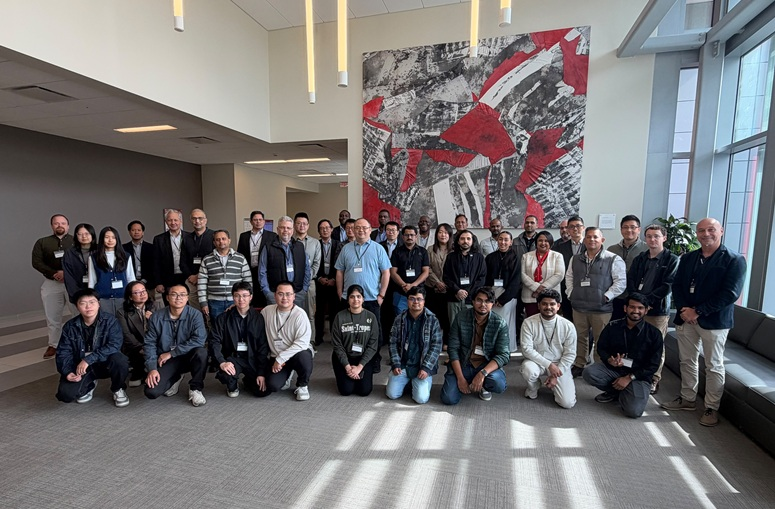

Group photo from the Data Center Grid Integration Workshop.

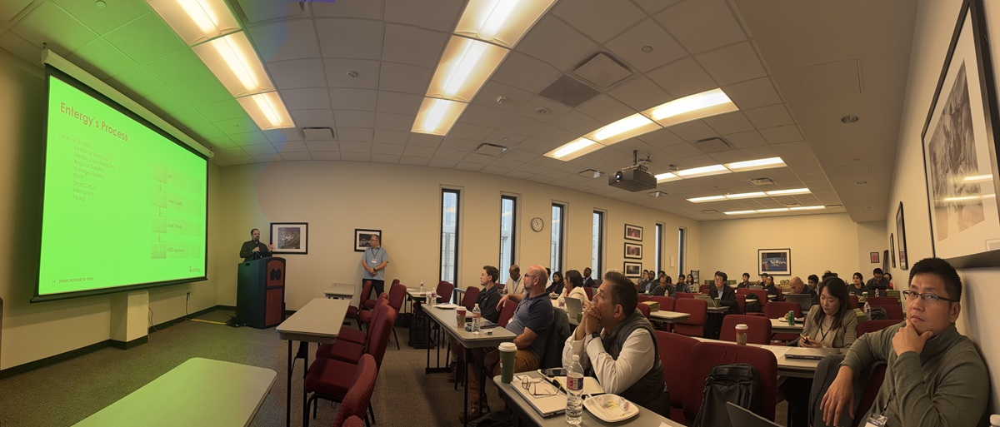

Technical presentations and discussions on data center-grid integration.

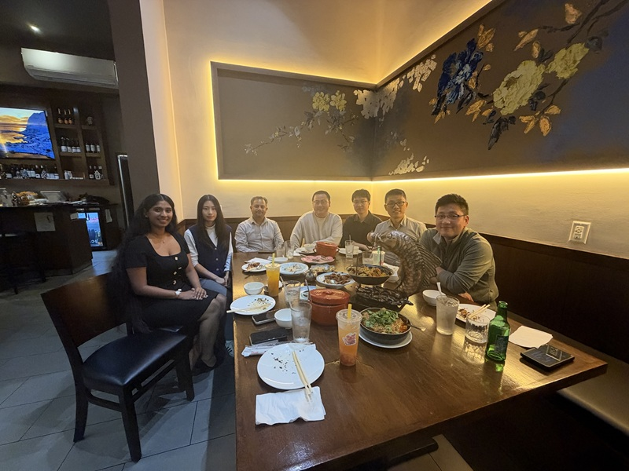

Workshop dinner.

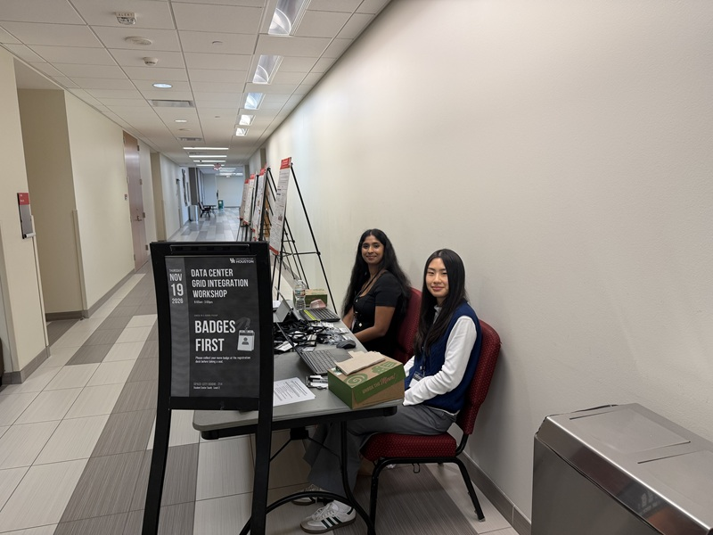

 Student volunteers <a target="_blank" href="/people/Ann-Mary-Toms/" class="">Ann Mary Toms</a> and <a target="_blank" href="/people/Fan-Jiang/" class="">Fan Jiang</a> (left to right) at the registration desk. 

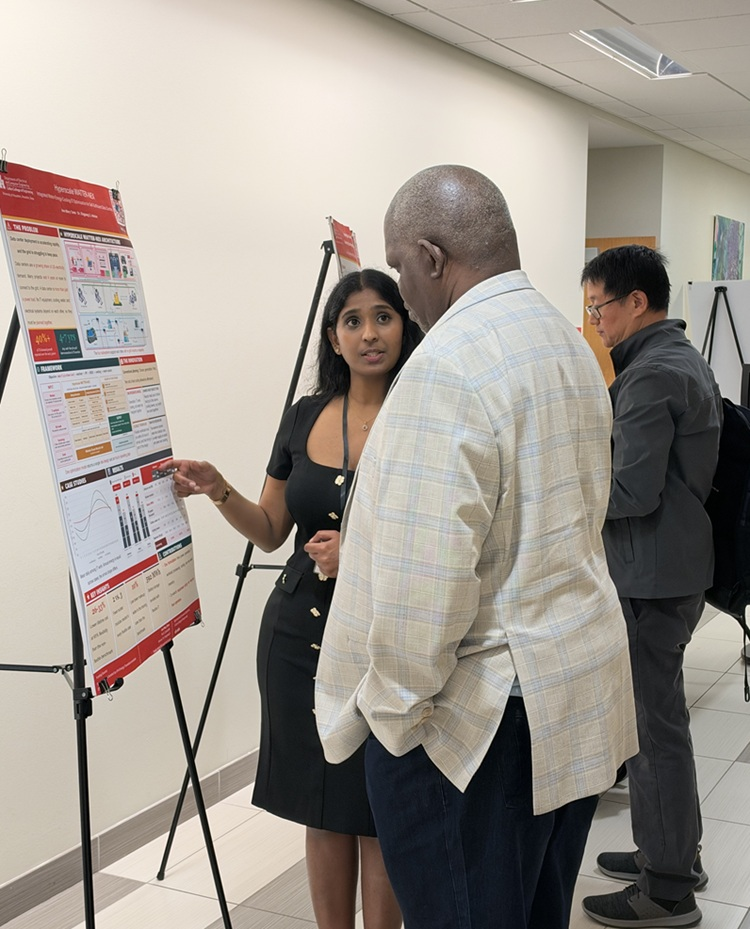

<a target="_blank" href="/people/Ann-Mary-Toms/" class="">Ann Mary Toms</a> presenting her Hyperscale WATTER-NEX poster.

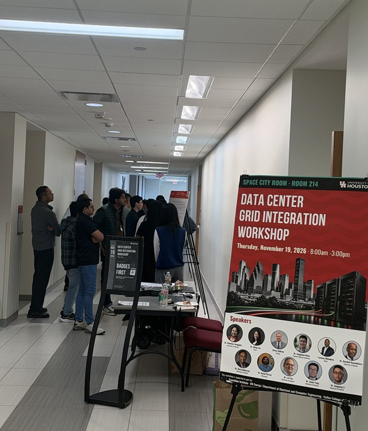

Student research poster session.

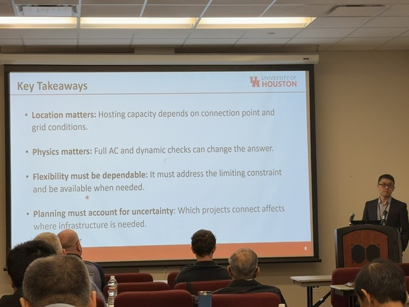

<a target="_blank" href="/people/Xingpeng-Li/" class="">Xingpeng Li</a>'s talk on data center hosting capacity.

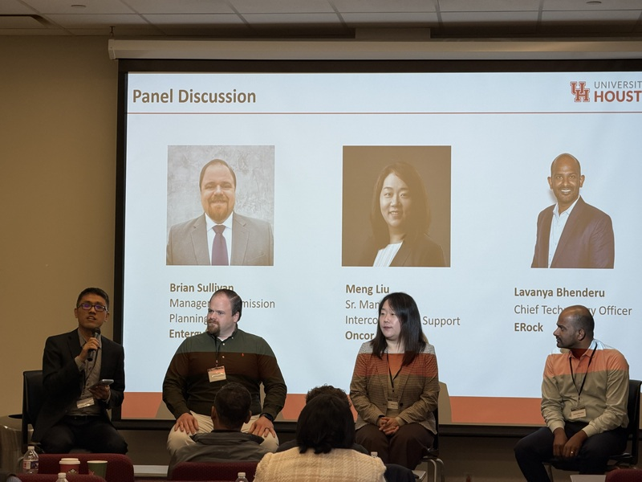

Utility/industry panel with Brian Sullivan (Entergy), Meng Liu (Oncor), and Lavanya Bhenderu (ERock), moderated by <a target="_blank" href="/people/Xingpeng-Li/" class="">Xingpeng Li</a>.

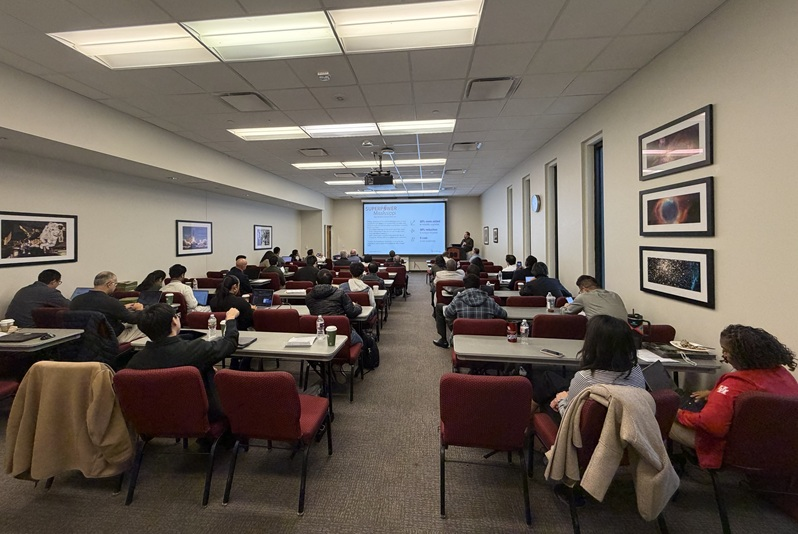

Brian Sullivan presenting data center impacts at Entergy.

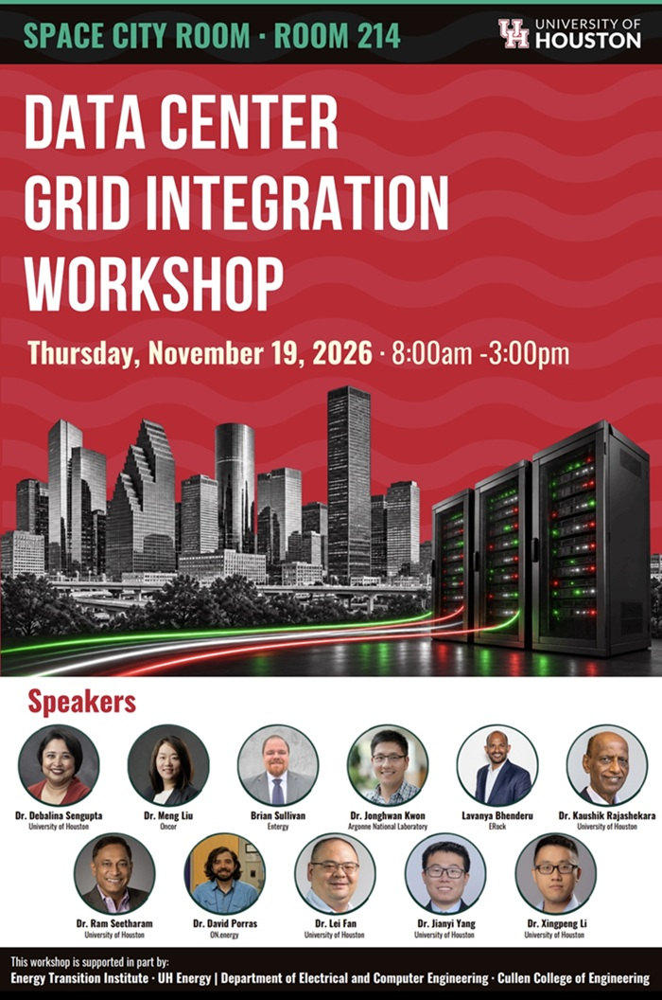

Workshop poster with the speakers.

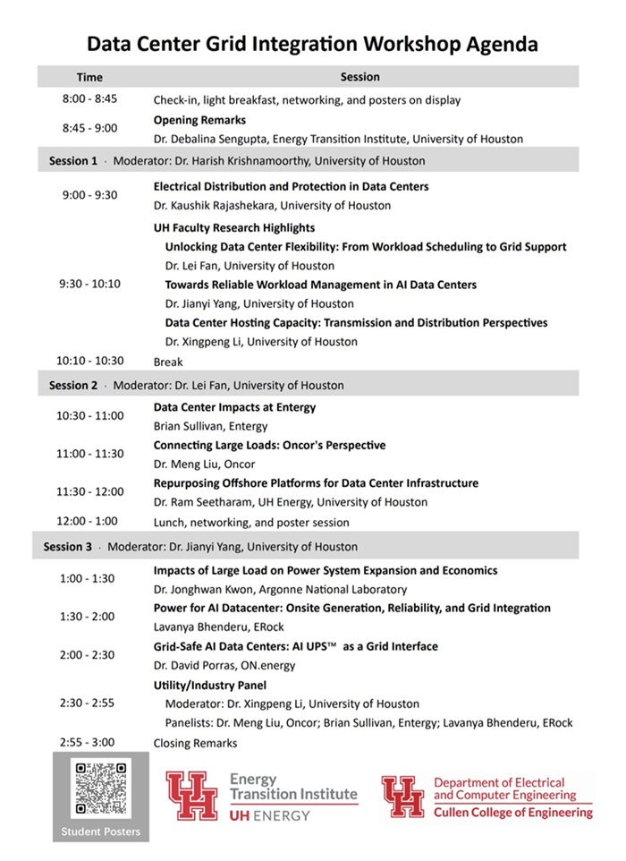

Workshop agenda.

